<p align="center">
  
</p>

<h1 align="center">个人信息中枢 · Summarizing</h1>

<h3 align="center">从碎片信息到完整的事项。</h3>

<p align="center">
  <picture>
    <source media="(prefers-color-scheme: dark)" srcset="docs/assets/screenshot-board-dark.png" />
    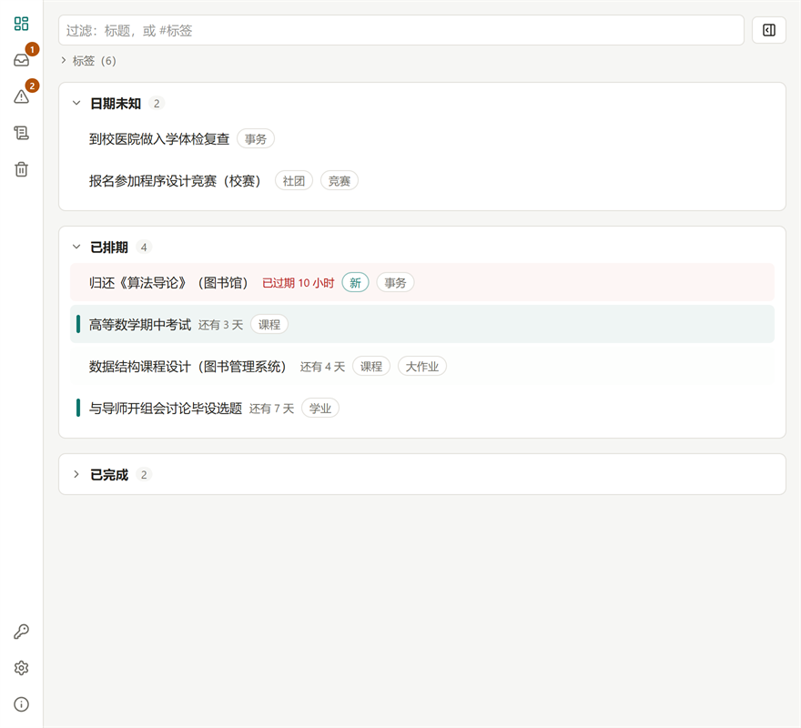
  </picture>
</p>

<p align="center">一条个人信息流水线：群通知、随手记、聊天碎片丢进来，AI 消化成完整的事项；不用做但值得知道的事进「通知」；拿不准的进存疑库，等你决定。</p>

<p align="center">
  <a href="#上手"><strong>上手</strong></a> &nbsp;·&nbsp;
  <a href="#界面一览"><strong>界面一览</strong></a> &nbsp;·&nbsp;
  <a href="#支持什么"><strong>支持什么</strong></a> &nbsp;·&nbsp;
  <a href="#之后的计划"><strong>之后的计划</strong></a> &nbsp;·&nbsp;
  <a href="SOURCE-GUIDE.md"><strong>开发信源</strong></a> &nbsp;·&nbsp;
  <a href="#设计文档"><strong>设计文档</strong></a> &nbsp;·&nbsp;
  <a href="LICENSE"><strong>AGPL-3.0</strong></a>
</p>

<p align="center">
  <a href="#"></a>
  <a href="#"></a>
  <a href="#"></a>
  <a href="#"></a>
  <a href="#"></a>
  <a href="#"></a>
  <a href="#"></a>
</p>

## 它解决什么

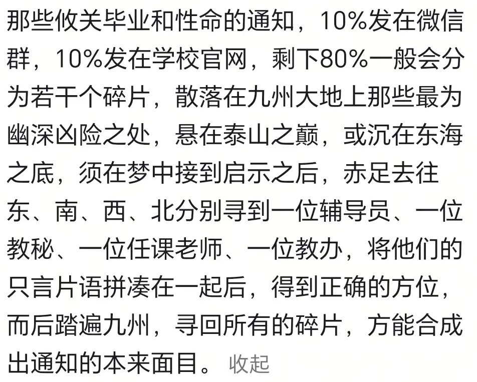

重要的通知总是散得到处都是：群里一半、官网一半，剩下的在几位老师的只言片语里。Summarizing 把它们收进同一个地方，由 AI 整理成完整的事项：带日期、带要素、带来源；不用你去做、但以后可能想回头查的，落成**通知**；整理不了的进存疑库。

和「稍后读」「聚合器」的区别：这里留下的是**整理过的事实**，不是待处理的链接。每一条都能点开查回最初那条消息。

## 支持什么

- **三段看板**：已排期 / 日期未知 / 已完成；按截止时间排序，标不标日期都不会被硬凑。越临近越显眼，过期的有淡红底，完成的行随时间淡出。
- **「新」与标签**：没打开过的事项带「新」标；点开即消。标签栏收在筛选栏下方，点标签就是筛选。
- **通知**：群里发来的、不用你去做但值得知道的事——「课改到明理楼3楼」「时间调到周五」——单独进**通知**页，不进看板、不带截止时间。进入页面自动选第一条；**左拖 = 稍后**（这一轮先跳过，不写库），**右拖 = 清除**（进回收站，两秒内可撤回）。通知更新后会重新标为未读，入口上显示未读数。
- **回收站**：删掉的信息先进回收站，随时恢复；删掉超过 15 天的才被「一键清理」真正清掉（清前二次确认）。**原文档案永远不删**，每条信息都能追回最初那条消息。
- **收取规则**：在设置里用大白话说出你不想要什么（「拼多多砍一刀链接不要」「早安图不要收」）。AI 把它当最高优先的硬闸——命中的一律不收（事项、通知、存疑库都不进）；**只拒你点名的，没提到的一律照常判断**。被拒的内容在流水里仍可查。
- **群机器人接入**：群里和私聊消息自动进站；按群号 / QQ 号白名单过滤（未配置 = 全不收）；同一会话静默一段时间后合并成一个批次再消化。
- **对话录入**：像聊天一样丢信息，AI 自己判断怎么处理；也可以问「这周有什么要交的」、@ 提及看板事项、让它「清扫存疑库」。
- **自动整理**：抽日期、抽要素、找归属、合并同一件事的多次提及；推断出来的日期标「推断」并写明依据。处理失败的批次标「未处理」，原文还在，可一键重试。
- **会读图**：群里发来的截图、海报、通知图，AI 能打开看清里面的字——截图上的截止日期、报名入口等信息照常提取（这类内容标「多模态/图片」标签，一眼可辨是「看图得来」而非原文明说）。取不到（如链接过期）就按纯文字处理，不会因为一张图卡住。
- **证据链**：事项的每个元素都能点开查来源——逐字引文、来源身份、原始批次。
- **来源信息**：展开一个事项能看到它的每一条消息来自哪（一行一条进站消息，点开见来源的全部细节与原文入口）。
- **存疑信息库**：拿不准的先存进库里（原话逐字 + 来源 + 需要人看的程度），不硬挂到事项上；之后可以人工清掉，也可以对 AI 说「清扫存疑库」让它复核。
- **流水**：每条信息从进站到成事项的全程留痕——消化中实时显示轮次与轨迹，完成后留档；漏掉、拒收、降级都看得见。
- **修改留痕**：每次改动都追加一份完整快照，历史随时可查。
- **信源可扩展**：新的消息来源按统一契约接入（[开发信源 →](SOURCE-GUIDE.md)）；信源自己声明设置项，界面自动渲染表单，core 和前端都不认识具体信源。
- **多账户（邀请制）**：每个账户一套独立的看板/对话/信源/数据（每人一库）；AI key 各用各的。单机自用 = 一个账户的实例。
- **自托管**：SQLite 单文件数据，拷走即备份；AI 走 OpenAI 兼容接口，可接本地模型。
- **外观**：深色模式（可跟系统）、六种主题色、三种字体、两档信息密度；手机也能用。

## 上手

要求：Node.js ≥ 22。

```bash
npm install
cp .env.example .env      # 可选：改 PORT 等环境变量（AI 接入不在这——每个账户在界面里配）
npm run admin -- user:add 你的名字   # 建账户（交互输密码；第一个账户就是你自己）
npm run dev                # 打开 http://localhost:5173 登录 → 设置 → AI 填你的接入
```

不想配环境？到 [Releases](https://github.com/Lotuses-robot/Summarizing/releases) 下载 **Windows 便携包**（内置运行时，解压双击 `start.cmd`，首次会自动引导建账户）。

想先看看长什么样：`npm run seed:demo` 会为演示账户载入一套虚构数据（登录 `demo`，密码见命令输出）。

装完之后，常用检查：

```bash
npm test              # vitest（447 个用例）
npm run check         # 类型 + 代码规范 + 测试
npm run check:dead    # 死代码检查
npm run build -w @summarizing/web
```

## 界面一览

<sub>展开体 · 元素与证据</sub>

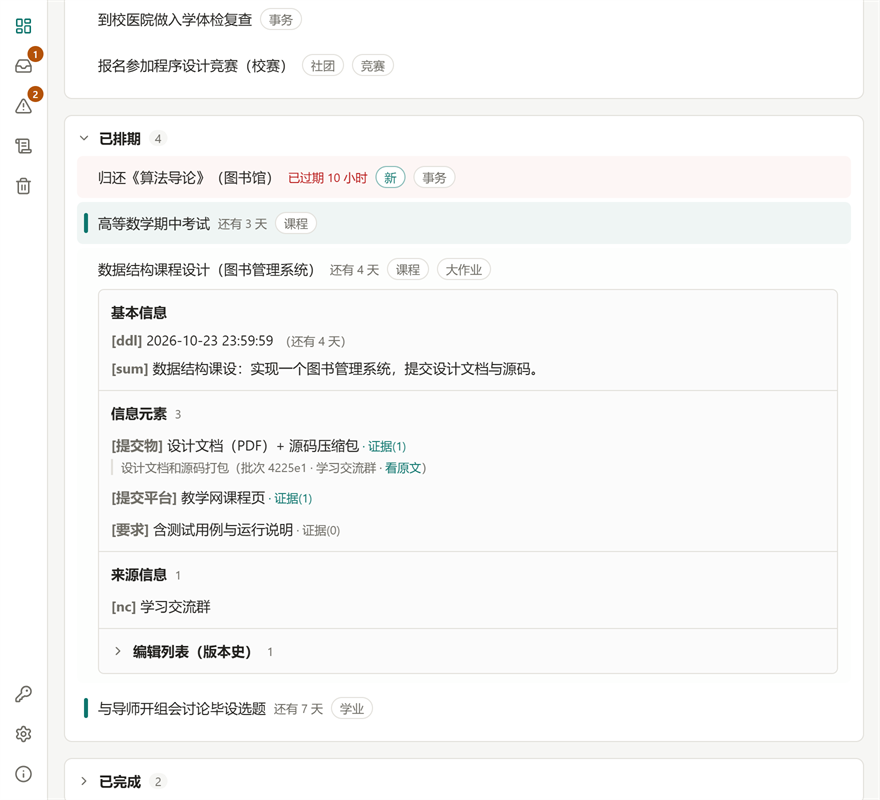

三段看板按截止时间排；点开一行是展开体——名字、ddl、摘要、每个信息元素都能点开查引文；来源信息一行一个进站批次。

<sub>通知 · 一张一张读</sub>

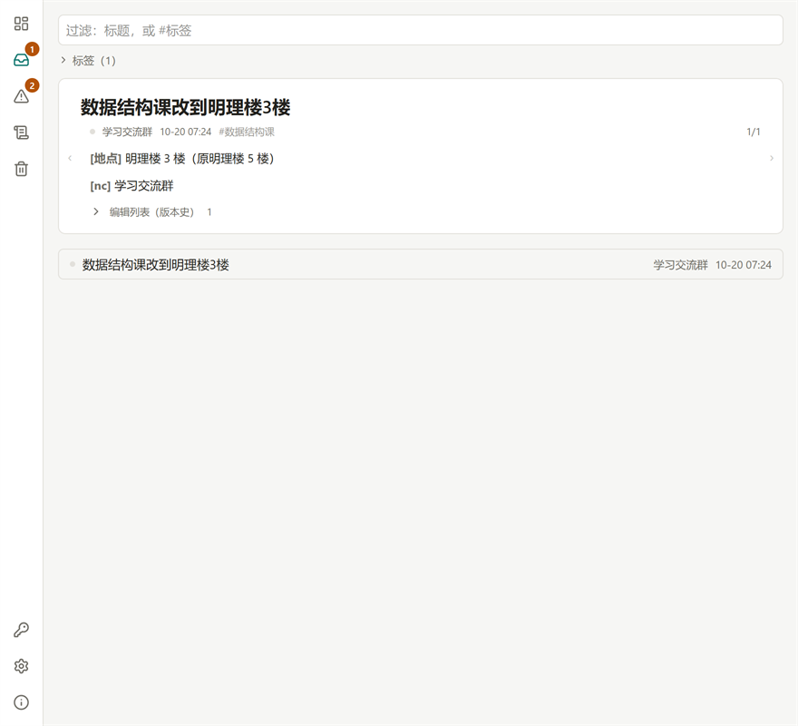

通知页是阅读器：上面一张主卡（完整内容 + 证据 + 来源），下面列表只做索引。左拖稍后、右拖清除，清除前有两秒可撤回。

<sub>流水 · 一条信息从进站到成事项</sub>

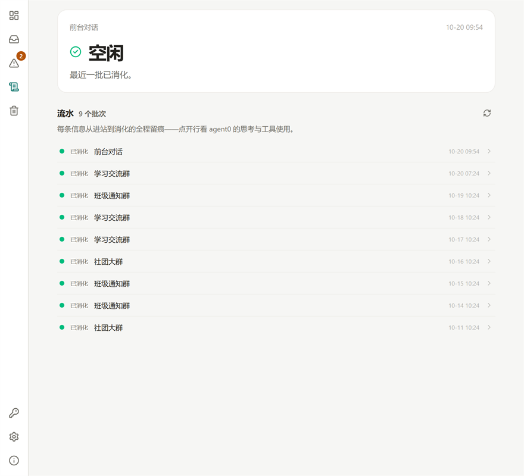

消化中的批次实时显示轮次进度与最近几条轨迹；完成卡停留三秒；点开任意批次看原文与全程事件——包括围栏拒收和降级。

<sub>存疑库 · 等人工决定</sub>

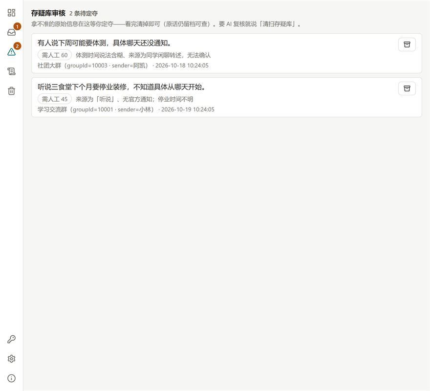

拿不准的进存疑库：原话、来源、需人工分与理由都在。看完清掉即可（原话仍留档），或者对 AI 说「清扫存疑库」。

<sub>回收站 · 删错了还能捡回来</sub>

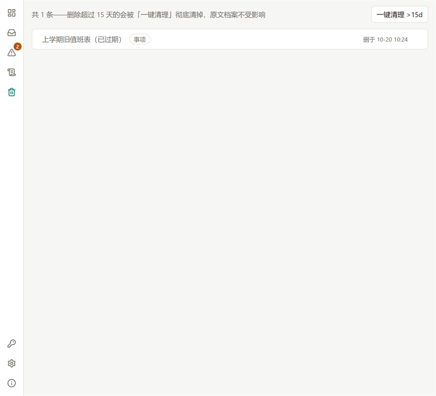

删除先进来，随时恢复；超过 15 天的才会被「一键清理」彻底清掉，而且不影响原文档案。

<sub>对话 · 怎么丢都行</sub>

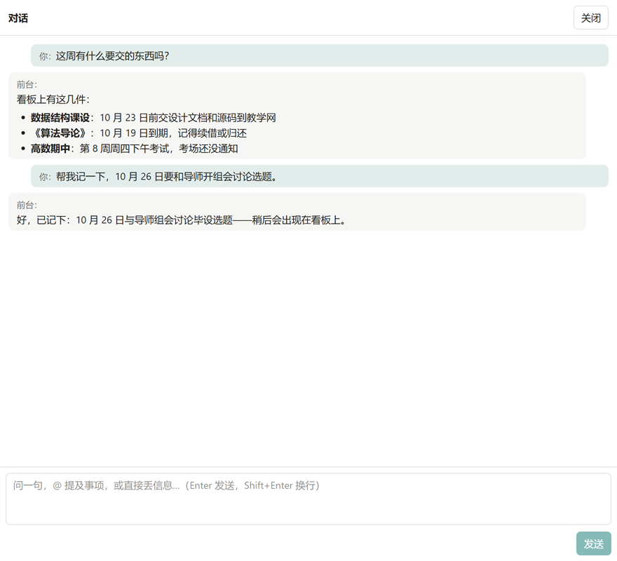

所有东西都可以像聊天一样丢进来；AI 用自然语言回复（Markdown 渲染）——该建事项的建，拿不准的进存疑库；也能查、能删、能替你清扫存疑库。

<sub>设置 · 信源自动渲染表单</sub>

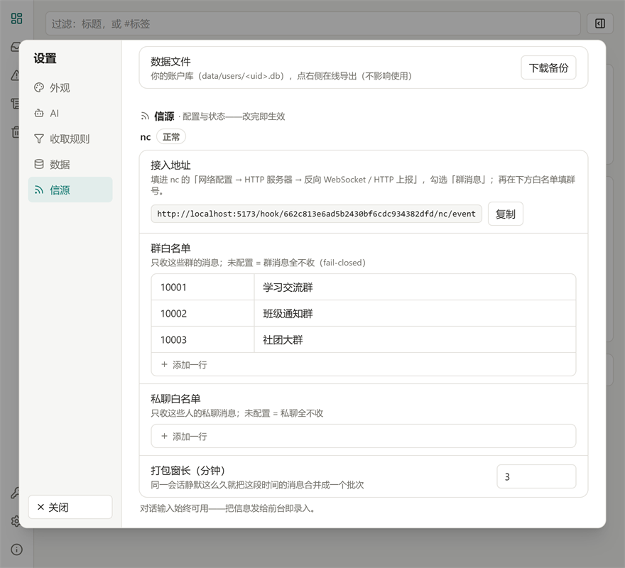

信源（消息来源）自己声明有哪些设置项，界面自动生成表单——改完即生效，没有保存按钮。外观、AI 接入、收取规则、数据备份各占一区。

<sub>外观 · 主题 / 色板 / 字体 / 密度</sub>

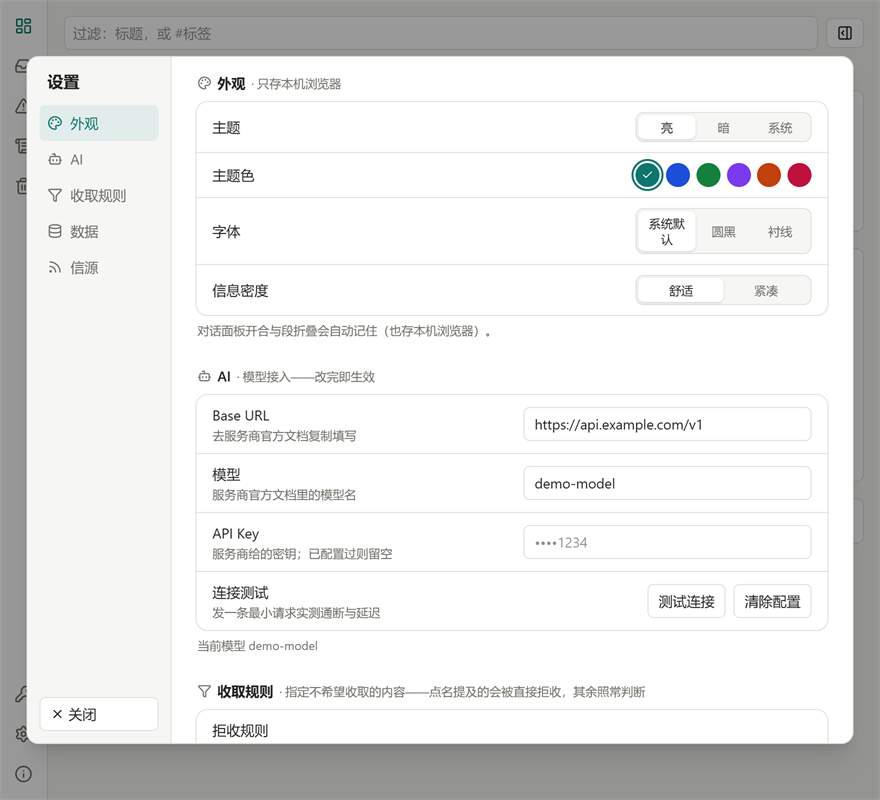

所有偏好只存本机浏览器，改完立即生效；「系统」主题会跟着系统明暗切换。

<details>
<summary>架构与实现细节（工程向）</summary>

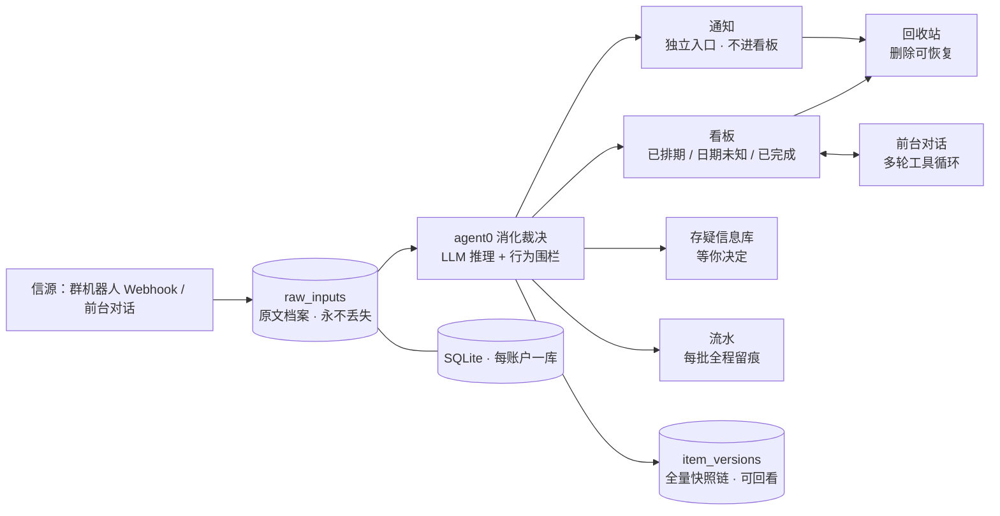

- **原文先行**：一切先落 `raw_inputs` 原文档案；AI 的输出永远只是派生结果，可回溯到原话。
- **证据链，不打分**：元素 → 逐字引文 → 原始批次，全链路可查；不生成「可信度」这类再生成值。
- **行为围栏**：代码只校验行为——动作白名单、引文逐字、引用存在、批内状态一致；不评判 AI 判断得对不对。
- **全量快照版本链**：每次变更追加完整快照，当前视图取最新；历史可回看。
- **写权独占**：只有 agent0 的执行器能写事项与证据，且必须过围栏；前台对话只能读 + 调受限工具。
- **信源契约**：适配器按统一契约接入，core 不认识具体信源；设置项声明式渲染。
- **每账户一库**：`data/users/<uid>.db`；账户登记在 `data/system.db`。构造隔离，不靠查询过滤。

</details>

## 目录结构

```
apps/server        Fastify + SQLite：存储 / 消化裁决（agent0）/ 执行器与围栏 / 信源宿主
apps/web           React 19 + Tailwind v4：看板 / 通知 / 存疑审核 / 流水 / 回收站 / 对话 / 设置
packages/shared    跨边界契约（zod schema 单一来源）
docs/              设计文档：数据契约 / 规格 / 决策台账 / 信源开发指南 / 上云与运维…
scripts/           admin（建账户/发邀请码/停用…）/ db:reset / seed:demo / build-release 等
```

## 设计文档

`docs/` 不是面向读者的文档——它是这个项目与 AI 协作者一起工作时的「记忆」：约束、决策、验收都留档，与代码同步演进（带着编号和修订批注，是正常的）：

| 文档 | 内容 |
| --- | --- |
| `docs/00-数据契约.md` | 数据层权威契约（表、字段、不变量） |
| `docs/01-规格.md` | 行为层权威规格（01§4.x 各子系统） |
| `docs/02-决策台账.md` | 全部决策编号（D-xx）与延后项（L-xx） |
| `docs/03-开放问题.md` | 当前批次未决事项与活跃约定 |
| `docs/04-验收.md` | 验收清单与真实走查记录 |
| `docs/07-接新源检查单.md` | 信源开发指南（接一个新源的全流程） |
| `docs/08-nc对接指南.md` | 群机器人信源对接操作手册 |
| `docs/09-信源可行性测试计划.md` | 信源阶段测试计划（含环境陷阱清单） |
| `docs/11-上云与发布.md` | 上云与发布全流程清单 |
| `docs/12-版本与发布.md` / `docs/13-部署运维.md` | 版本规范 / 服务器初始化与升级 runbook |

单实例多账户：自己一个人用是默认形态，也可以邀请几位熟人各用各的（邀请制注册，每人独立数据库）。云同步、原生移动 App 不在当前范围内。

## 之后的计划

下面几项还没做，列在这里是想说清方向，不是已有的能力：

- **图片持久化**：图片消息现在只留链接占位（链接会过期），之后把图片本身也存下来，过期后仍可回溯。
- **外链支持**：贴进来的网页 / 公众号链接，由 AI 取回正文再整理（现在只留链接本身）。
- **ITSC 信源**：把学校 ITSC 系统接成又一个信源，走同一套适配器契约。

## License

[AGPL-3.0](LICENSE)。自由使用、修改、自托管；把修改版作为网络服务对外提供时，须按同许可证开源。
